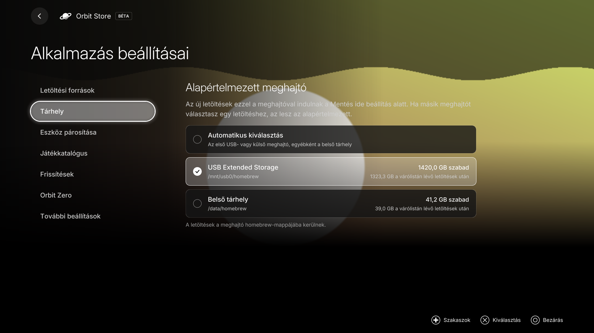

# Orbit Store (Beta)

### A modern, no-BS download manager for PS5.

Orbit runs on your PS5. Pick a game, choose its source and format, and Orbit downloads it straight to the console or a drive plugged into it. Use it on your TV with a controller from the Games row, or pair a phone or computer to manage the same downloads over your home network.

**[Orbit Zero](#orbit-zero-for-mac-windows-and-linux)** brings Orbit to Mac, Windows and Linux. Download games on your computer and send them to your PS5 straight away or later, without your PS5 needing internet access.

Explore **2,090 games: 1,119 PS5 games and 971 PS4 games**, plus **626 DLCs and add-ons for 192 games**, with single-file downloads from Archive.org, Vikingfile and AkiraBox. Filter by platform, choose your source and save to your preferred drive. New games, add-ons and corrected links arrive through catalogue updates. For PS4 packages, see [PS4 games on PS5](guides/downloads.md#ps4-games-on-ps5).

<p>
  <a href="assets/1.5.0/native-crossbar-discover.jpg?raw=1"></a>
  <a href="assets/1.5.0/native-store-game-details.jpg?raw=1"></a>
</p>

<div align="center">

[Download Orbit](https://github.com/saawant12/orbit-store-ps5/releases/latest) · [Orbit Zero](#orbit-zero-for-mac-windows-and-linux) · [Get started](guides/getting-started.md) · [Download guide](guides/downloads.md) · [DLC guide](guides/add-ons.md) · [Library guide](guides/library.md) · [Appearance guide](guides/appearance.md) · [Notifications](guides/notifications.md) · [Troubleshooting](guides/troubleshooting.md) · [Bug report format](.github/ISSUE_TEMPLATE/bug_report.md) · [Report a bug](https://github.com/saawant12/orbit-store-ps5/issues/new?template=bug_report.md) · [Request a feature](https://github.com/saawant12/orbit-store-ps5/issues/new?template=feature_request.md)

</div>

> **Also from Orbit: [Orbit Play](https://github.com/saawant12/orbit-play-ps5)** — Stream your jailbroken PS5 to Mac, Windows or Linux over your local network, without PSN sign-in. **Beta available now.**

## Features

**Find games**
- **Discover and Browse** with platform, source, format, region and size filters, plus eight [game tags](guides/downloads.md#game-tags).
- **Saved filters.** Name your filters once and apply them again in the browser, TV app or Orbit Zero. [Guide](guides/saved-filters.md)
- **DLC and add-ons** from the Add-ons page or a game’s details. [DLC guide](guides/add-ons.md)
- **Firmware checks.** Known firmware requirements are shown beside each download option.

**Download**
- **One link per download.** FFPFSC, exFAT, PKG, FPKG, ZIP, RAR or 7z, with archives extracted automatically.
- **A queue you control.** Pause, resume, retry and reorder, with up to 8 games at once.
- **Optional accounts** for [TorBox](guides/downloads.md#optional-download-through-torbox), [Archive.org](guides/downloads.md#archiveorg-sign-in) and [Vikingfile](guides/vikingfile.md).
- **Notifications** on your PS5, phone or computer. [Setup](guides/notifications.md)

**Install and manage**
- **Install without leaving Orbit.** PKG and FPKG through Orbit, game images and folders through ShadowMount. [Guide](guides/install-games.md)
- **Library** of installed games and game files on every drive, kept up to date automatically. [Library guide](guides/library.md)
- **File manager** for your PS5’s drives: copy, move, rename, delete, unpack and install. [Files guide](guides/files.md)

**Use it your way**
- **Native TV app** built for your controller. Downloads keep running when you close it.
- **Four interfaces:** Store, Crossbar, Cinema and Panorama. [Appearance guide](guides/appearance.md)
- **Control from your phone.** Pair once to browse, queue and follow downloads.
- **[Orbit Zero](#orbit-zero-for-mac-windows-and-linux)** for Mac, Windows and Linux, with [stream installs](guides/stream-install.md) from your computer.
- **Updates when you choose**, for the TV app and service together.
- **No Orbit account. No telemetry.**

## New in 1.7.0

Orbit 1.7.0 adds [Files](guides/files.md), [shared saved filters](guides/saved-filters.md), [Vikingfile account sign-in](guides/vikingfile.md) and [Stream & install from Zero](guides/stream-install.md). Cinema’s Library and Downloads use Store’s layout in Cinema colours. These changes require the matching new apps; they are not added by refreshing the catalogue.

## Get started

**Three ways to use Orbit**

| Do this | Orbit appears in | What it is |
|---|---|---|
| Copy `PPSA99177.ffpkg` to `/data/homebrew/` | **Games** on your PS5 | The TV app, used with your controller. Needs kstuff and ShadowMountPlus. |
| Run `orbit_store.elf` with your payload manager or ELF loader | **Media** on your PS5 | The browser version. It only opens while Orbit is running. |
| Install [Orbit Zero](#orbit-zero-for-mac-windows-and-linux) | Your Mac, Windows or Linux computer | Downloads on your computer and sends the files to your PS5. The PS5 doesn't need internet. |

The Games and Media versions share the same downloads, favourites and service settings, so seeing two Orbit icons on your PS5 is normal. Appearance is saved separately in each app or browser.

For direct console downloads, you need a PS5 that can run homebrew ELF payloads, a payload manager or ELF loader, internet access on the console, and enough writable storage. For downloads through your computer, see [Orbit Zero](#orbit-zero-for-mac-windows-and-linux) below.

1. **Choose how to open Orbit.** Download the files from the [latest release](https://github.com/saawant12/orbit-store-ps5/releases/latest), verify them and follow the table above. Use the Games version, the Media version or both.
2. **Choose your sources.** Choose sources in the TV app’s setup screen or **App settings → Download sources**. Select the sources you want to use, including Archive.org, Vikingfile and AkiraBox, and acknowledge the download notice. Your choices apply across both versions.
3. **Pick a download.** Open a game and select its main download button to review **Download options**. Choose **Source**, **Download using** and **Save to**, then confirm the download. Direct options download from the TV app. Vikingfile first checks for a direct link using your sign-in; options needing verification open the provider page on the PS5, keeping your selected game, source and drive. Choose **Open Vikingfile on PS5** in the native app or **Open download page on PS5** in the browser version. For **Vikingfile and AkiraBox**, complete verification and wait without pressing Download. Orbit captures the matching link and returns to the app automatically.
4. **Follow your queue.** Open Downloads on the TV or a paired device to check progress, pause or resume.

The TV app includes Orbit's download service and can start it through a compatible ELF loader on **port 9021**. You can also start `orbit_store.elf` yourself. The Media-tab shortcut opens the browser version while the service is running. After a reboot, start your jailbreak before opening Orbit. See the [setup and update guide](guides/getting-started.md) for installation, updates and phone pairing.

## See how it works

Open Orbit from your Games row and use the controller to browse, explore and choose a download. The native app shares your catalogue, favourites and download queue with the browser version.

*The previews below were captured for Orbit 1.5.0. The new [Files](guides/files.md), [Saved filters](guides/saved-filters.md), [Vikingfile](guides/vikingfile.md) and [Stream & install](guides/stream-install.md) guides show the 1.7.0 screens.*

### Discover, browse and choose a download

**Start with something new.** Discover opens first. **New on Orbit** brings featured picks and recent additions to the first row, followed by **Latest releases**. Move down to All games to explore a grid that loads more games as you scroll. PS4 and PS5 editions have their own platform labels and download choices.

**Store (default)**


**Keep exploring.** All games gives each title its own tile. Move through the grid with your controller; more games appear as you keep scrolling.


**Find your next game.** Search by name or title ID, narrow the collection by platform, source, format, region or size, and browse the newest known releases first.


**Get to know a game.** Read its description, save it to favourites, or open the three-dot menu for more information. The main download button opens your options before anything starts.


**Choose how and where to download.** Review the source, format, delivery method and drive together. Direct options download from the TV app; Vikingfile uses your saved sign-in when available and opens its provider page if verification is needed, keeping your choices when you return. See the [download guide](guides/downloads.md), including [TorBox setup](guides/downloads.md#optional-download-through-torbox).


### Choose your interface

Make Orbit look the way you like. Open **Appearance** and choose **Store**, **Crossbar**, **Cinema** or **Panorama**. Confirm your choice to keep it. The interfaces are available in the native PS5 app, browser and Orbit Zero; switching keeps your downloads, favourites and settings. See the [appearance guide](guides/appearance.md) for the 15-second confirmation, controller shortcuts, motion options and where to find settings in each layout.

**Crossbar**


<br>

**Cinema**


<br>

**Panorama**


### Choose how Orbit works

The instructions below use Store’s settings names. In the browser’s Crossbar, Cinema and Panorama interfaces, use the [Settings page equivalents](guides/appearance.md#find-settings-after-switching).

Choose sources, set your default drive, pair a phone and refresh your game catalogue from one place. **Update Orbit** updates the TV app and download service together; you choose when to install or restart.


### Orbit in your language

Orbit Store and Orbit Zero support **English, German, Spanish, French, Hungarian, Italian, Dutch, Polish, Brazilian Portuguese, Russian and Turkish**. In the native app, choose a language in **App settings → Appearance**, or keep **Automatic** to follow your PS5’s system language. In the browser version, use **App settings → Language** in Store, or **Settings → Language** in the other interfaces, to choose a language for that device, or leave it on **Automatic** to follow the browser.



*Native app 1.3.2 rendered locally in Hungarian. Storage values are illustrative.*

In Orbit Zero’s Store interface, use the globe-shaped **Language** button in the top bar. In Crossbar, Cinema or Panorama, open **Settings → Language**. Language settings change Orbit’s menus; each game keeps its own language settings. See [language settings](guides/getting-started.md#choose-your-language) for instructions and the browser selector.

### The same queue on your phone

Pair a phone on the same network to find a game and choose its download option. Files still go to the PS5’s selected drive. Vikingfile’s provider page and any verification open on the **PS5**, even when you start from your phone.

1. **Find a game.** Search the catalogue and filter the available games.
2. **Open the game.** Read its details and find available add-ons.
3. **Start the provider step.** Open Vikingfile on PS5, complete verification and wait. Orbit captures the matching link and returns automatically.

<p>
  <a href="assets/1.5.0/phone-browse.jpg"></a>
  <a href="assets/1.5.0/phone-game-details.jpg"></a>
  <a href="assets/1.5.0/phone-download-options.jpg"></a>
</p>

*Select a screenshot to open it at full size.*

For your existing collection, the [Library guide](guides/library.md) explains installed, mounted and on-drive status, plus the actions available through ShadowMount.

## Orbit Zero for Mac, Windows and Linux

Orbit Zero is our desktop companion for Mac, Windows and Linux. [Download Orbit Zero](https://github.com/saawant12/orbit-store-ps5/releases/latest) to save games on your computer, even without a connected PS5. When you're ready to transfer, open **Console**, enter your PS5’s local IP address and choose **Start Orbit on PS5**.

Download on your computer and transfer to your PS5 over your home network. Uncompressed files can transfer while downloading; archives finish downloading and extracting before their files transfer. **Works over your local network: Wi-Fi or Ethernet. Your PS5 does not need internet access.** Keep both devices connected to your home network while transferring to PS5.

- **Download now and send to PS5 later.** Choose **Save to → This computer** to keep a game on your computer. Connect your PS5 when ready, then select **Send to PS5** in Downloads. [See the steps](guides/orbit-zero.md#download-now-and-send-to-your-ps5-later).
- **Start Orbit from your computer.** Upload and launch the compatible payload without a separate ELF download or manual file selection. Your PS5 must already have its jailbreak and Payload Manager or an ELF loader running.
- **Control downloads from either device.** Browse and manage the computer’s queue from the desktop or the matching native Orbit app on your PS5.
- **Choose where downloads run.** Use **Computer** to download through your computer, or **Prefer PS5** to download directly when the console can reach the source. Save your preference once.
- **Follow each stage.** See download and PS5 transfer rates and estimated time remaining separately, plus extraction progress for archives, with controls to pause, resume and reconnect.
- **Recover an interrupted transfer.** Resume after a connection failure, reconnect your PS5 at its new address, or remove a stuck queue entry while keeping its files. [Compare the recovery choices](guides/orbit-zero.md#pause-reconnect-and-clean-up).
- **Reuse completed computer downloads.** Recover a finished file whose queue entry was removed, including older `.cache` files, then transfer it without downloading it again. See [cache recovery](guides/orbit-zero.md#recover-a-completed-computer-download).
- **Install after transfer.** Open **Downloaded files** and choose **Install on PS5** once a game or add-on reaches the console. Select each package you want from a bundle.
- **Export a diagnostic log.** **Download settings → Export log** saves a report for support, including PS5 diagnostics when connected. Titles, filenames, paths, links, passwords and tokens are excluded.
- **Use your accounts on the computer.** Download settings includes Archive.org sign-in and TorBox for supported sources. Computer accounts are separate from the PS5 service’s accounts.
- **Download more at once.** Download one game to your computer at a time by default, or choose 1–8 in Download settings. PS5 transfers run one at a time while computer downloads continue.

[Install on Mac, Windows or Linux](https://github.com/saawant12/orbit-store-ps5/blob/main/guides/orbit-zero-installation.md) · [Set up a PS5 without internet](https://github.com/saawant12/orbit-store-ps5/blob/main/guides/orbit-zero-offline-ps5.md)

**Download and transfer improvements are included as standard.** It reconnects to your saved PS5 when reopened, lets you choose the computer download folder, and can clear completed computer copies after successful transfers. **Updates** checks for new desktop versions and downloads the correct package when you choose.

### Discover on your computer

Explore PS4 and PS5 games with full artwork, featured picks in New on Orbit and a shared favourites list. Browse’s **Platform** filter lets you choose PS4, PS5 or both. Choose the source and either **This computer** or a PS5 destination before starting a download.


### Your PS5, at a glance

The Console page brings your connection, available storage, download preference and active transfers together. Pair once using **Show code on PS5**, then manage the connection from your computer.


*Console before connecting a PS5. Its storage and transfers appear after pairing.*

The desktop app supports **ARM64 and x64** computers and the same **11 interface languages** as Orbit Store. Use **Language** in Store’s top bar, or **Settings → Language** in the other interfaces. Choose a language, or **System language** to follow your computer. Keep Orbit Zero and the PS5 awake while transferring; the computer needs internet to fetch new downloads.

## Beta status

**Orbit Store is an experimental beta.** [Download the latest release](https://github.com/saawant12/orbit-store-ps5/releases/latest). The matching components in release **1.7.0** have these version numbers:

| Component | Version |
| --- | --- |
| Orbit Store download service and browser interface (`orbit_store.elf`) | **1.7.0** |
| Native TV app (`PPSA99177.ffpkg`) | **1.11.0** |
| Orbit Zero for desktop | **1.7.0** |

The TV app has its own version number; these files belong to the same release. Use matching files when updating. Keep the PS5 awake while downloading or receiving transfers.

**Payload-manager setup is opt-in.** Choose **App settings → Payload managers → Add Orbit** to let Orbit add and update a copy. Existing copies stay in place until you choose whether to allow updates. Auto-start is a separate choice, and Orbit leaves your manager's global Autoload switch unchanged.

Compatibility varies by PS5 firmware, loader and ShadowMount version. Library requires a compatible ShadowMount v1 local API, and available actions depend on your setup. If something goes wrong, use the [bug report format](.github/ISSUE_TEMPLATE/bug_report.md) and include your versions and the error shown. The reported etaHEN payload-toggle issue remains under investigation.

Older apps receive only catalogue data their version supports. Some older feeds stay at their last compatible revision, so updating the app may be necessary to see newer additions. A catalogue refresh alone does not add PS4 browsing, DLC or installation controls. Your queued downloads keep the files you originally chose.

## Using the beta

The [release downloads](https://github.com/saawant12/orbit-store-ps5/releases/latest) include:

- Orbit Zero for Mac, Windows and Linux, in ARM64 and x64 builds. Follow the [desktop installation guide](guides/orbit-zero-installation.md).

- [PPSA99177.ffpkg](https://github.com/saawant12/orbit-store-ps5/releases/latest/download/PPSA99177.ffpkg), the native TV app, and [its checksum](https://github.com/saawant12/orbit-store-ps5/releases/latest/download/PPSA99177.ffpkg.sha256).
- [orbit_store.elf](https://github.com/saawant12/orbit-store-ps5/releases/latest/download/orbit_store.elf), the download service and browser interface, and [its checksum](https://github.com/saawant12/orbit-store-ps5/releases/latest/download/orbit_store.elf.sha256).
- The complete source and licence bundle for the PS5 service, browser interface, native TV app and their open-source components, with build instructions.

The ELF and FFPKG each have a matching `.sha256` file. Desktop packages use the release’s **`SHA256SUMS`** file. Follow the verification commands for [PS5 files](guides/getting-started.md#verify-the-ps5-files) or [desktop packages](guides/orbit-zero-installation.md#verify-your-download), then use the installation guide for your app.

To download Orbit through **Payload Manager**, open **Settings → Manage Sources → Add Source** and paste:

```text
https://raw.githubusercontent.com/saawant12/orbit-store-ps5/main/payloads.json
```

Open the **Orbit Store** source, download **Orbit Store (Beta)**, then run `orbit_store.elf`. The feed includes its version and SHA-256 checksum using the [Payload Manager repository format](https://github.com/itsPLK/ps5-payload-manager/blob/main/CUSTOM_REPOSITORIES.md).

For the browser setup, manager integration and phone pairing steps, follow [Getting started](guides/getting-started.md). Only download material you have permission to obtain and use.

After a reboot, run your jailbreak as usual. Open the Games-row TV app to start Orbit through your ELF loader, or start the payload manually or through auto-start you have configured. The Media-tab browser shortcut needs Orbit already running. If auto-start does not launch Orbit on your setup, start it manually from your payload manager.

Keep the PS5 awake while downloading. Closing the storefront leaves downloads running. After an unexpected interruption, downloads recover paused for review. The **Restart Orbit** action resumes downloads that were active before that controlled restart.

## Updating or reinstalling Orbit

**Update Orbit in one step.** In 1.5.0 and later, choose **Update Orbit** under the native app’s **App settings → Updates**, or the browser’s **App settings → Update / reinstall** (**Settings → Updates** in other layouts). It updates the TV app and download service together. With an ELF loader running on port 9021, Orbit restarts its service and resumes the downloads interrupted by that restart. Reopen the TV app to use its update. If no loader is available, follow Orbit’s manual start instructions. **Restart Orbit** restarts only the service. See the [update guide](guides/getting-started.md#update-the-tv-app).

To restore a deleted Orbit icon, start Orbit through your payload manager. Your paired devices, source choices and download queue stay saved.

Loading an ELF while Orbit is already running saves the replacement for the next start. It does not switch the active session. The notification now explains this; an existing icon is expected and does not need to be removed.

**For older versions or a manual service update:**

1. Open **App settings → Update / reinstall → Check for updates**.
2. Choose **Install update**, or **Reinstall release** for the current published version. Orbit downloads the official ELF and verifies its SHA-256 checksum before replacing the saved copy.
3. When **Restart needed** appears, select **Stop Orbit to restart** and confirm. Your queue is saved and paused; other payloads keep running.
4. Run `/data/orbit-store/orbit_store.elf`, or a manager copy you opted to keep in sync, and reopen Orbit. Review and resume your downloads.

**Stop syncing** preserves the existing manager copy and its auto-start settings, but stops updating that copy. If you prefer to keep a manually imported ELF outside sync, replace it yourself when updating or launch the saved path above. Running an old imported ELF starts that older version.

The panel shows **Running**, **Saved for next start**, and **Latest release** separately. Pairing, source choices and the download queue are preserved. Updates are manual; no release is installed just by opening the panel. If a download or copy fails, Orbit reports the error and leaves the running session open for a retry.

For installations from older betas and queue compatibility, see [Upgrading an older version](guides/getting-started.md#upgrading-an-older-version). For the desktop app, follow [Update Orbit Zero](guides/orbit-zero-installation.md#update-orbit-zero).

## Managing your downloads

Choose **1–64 connections per download** in **App settings → Storage**; eight is the default. Active PS5 downloads share a total budget of 64 connections. Sources need byte-range support and a strong file identity to use multiple connections. Orbit retries with fewer when a host refuses, and existing partials keep their original layout. Pause, Resume and Cancel apply to the entire download. Speed depends on the host, network and storage.

Open **Downloads** and choose **Active**, **Finished**, **Failed** or **Cancelled**. Finished contains only successfully completed downloads; cancelled items have their own view. Move waiting downloads up or down to choose what runs next. Paused items keep their place. A retry countdown tells you when Orbit will try an interrupted download again.

On a cancelled download, **Delete download** offers to delete the partial file and remove the entry together. If you already deleted the partial file, it still removes the entry; completed files are kept. Reconnect the original destination if Orbit asks for it.

**Remove from history** keeps files on the drive. **Clear finished history** and **Clear cancelled history** also keep files and affect only their own view; cancelled entries with kept partial files remain listed. Use **Delete download** when you want to remove a cancelled entry and its partial file.

Before queuing a game, check **Free now**, **Unfinished downloads** and **After queue + this download**. Paused and failed downloads count toward the estimate; cancelled ones do not. Other apps can change free space, so Orbit checks again when a download starts.

Files are saved in the selected drive’s `homebrew` folder. See [where downloads are saved](guides/downloads.md#where-downloads-are-saved) for internal, M.2 and USB paths. For computer downloads, see [Orbit Zero transfer recovery](guides/orbit-zero.md#pause-reconnect-and-clean-up).

## Your Library

Open **Library** to see installed games and game files reported on your drives, including their mount and availability status. Search by name, title ID or path and filter by status, location or format. Library works independently of your download-source choices.

Run a compatible **ShadowMount with its v1 local HTTP API enabled** on the same PS5. Orbit reads that local inventory and shows the actions your ShadowMount version supports. It does not start ShadowMount or change its configuration.

- Library and drive information refresh automatically, and game sizes are measured in the background. **Scan for games** remains a manual fallback.
- Open a game to **mount or unmount** its compatible source. Orbit does not launch games or uninstall them.
- **Copy** keeps the original; **Move** asks ShadowMount to remove it after a successful transfer. Unmount the source first, select the destination and confirm. Pause active and queued Orbit downloads before starting.
- Open **Library → Files** to browse drives and manage files. Folders open directly; their separate action controls let you copy, move, rename, delete, unpack and install. See the [Files guide](guides/files.md).

If ShadowMount is absent or its API is incompatible, Library explains what is missing. A disconnected source stays distinguishable from an available one; refreshing does not delete files.

## Finding and saving games

In **Browse**, combine platform, source, format, region and download-size filters, then choose a sort order. Size sorting uses the smallest option matching your filters. **Release date (newest first)** is the default. Games without a recorded date appear afterward, alphabetically. **Reset filters** restores this order.

Open a game's details and choose **Add to favourites**, or use the favourite shortcut on a selected game in native Browse or Discover: **Square** in Store, **Triangle** in Crossbar, Cinema or Panorama. Your favourites are shared between the console and paired devices and stay saved after restarting Orbit. Disabling a source hides its games without forgetting your favourites.

## Refreshing the game catalogue

New games appear automatically, without reinstalling or restarting Orbit. To check for additions yourself, open **App settings → Game catalogue → Refresh catalogue**. Orbit also checks when it starts and every six hours while running. If newer additions are missing, install the latest Orbit apps and refresh again. Older app versions may keep an earlier compatible catalogue.

If your connection drops, you can still browse the last available catalogue. Reconnect to download games or get the latest additions. Your source choices and queued downloads stay as you left them.

## Controls and formats

In the native TV app, use the D-pad or left stick to move, Cross to select, Circle to go back, and follow the on-screen action hints. In the Store interface, **L1/R1 switches tabs** and **Square adds or removes the selected game from favourites in Browse and Discover**. Filters open with Cross; choose with the D-pad and Cross, or close with Circle. In Crossbar, Cinema and Panorama, **Triangle** toggles favourites instead; section navigation also differs. See the [native controller guide](guides/appearance.md#controller-navigation-in-the-native-app). The table below applies to the browser’s Store interface.

| Control | Action |
|---|---|
| D-pad / arrow keys | Move focus |
| Cross / Enter | Select |
| Search: Up / Down | Return to the Browse tab / move to results; with no matches, Down reaches collection controls |
| Search: Left / Right | Move the text cursor |
| Circle / Escape | Back or close details |
| Touch / mouse | Select visible controls |

The catalogue offers single-file **FFPFSC**, **exFAT**, **PKG**, **FPKG**, **ZIP**, **RAR** and **7z** options across Archive.org, Vikingfile and AkiraBox. Archive sizes are marked as compressed; the extracted files need additional space.

| Format | What you get | What to do after it's saved |
|---|---|---|
| **exFAT** | `.exfat` image | ShadowMountPlus mounts it. Nothing to install. |
| **FFPFSC** | `.ffpfsc` image | ShadowMountPlus mounts it. Nothing to install. |
| **Game folder** | A folder of game files, from an archive | ShadowMountPlus mounts it. Nothing to install. |
| **PKG**, **FPKG** | `.pkg` package | Choose **Install on PS5** in 1.5.0 and later, or use your compatible package installer on earlier versions. ShadowMountPlus does not mount `.pkg` files. |
| **ZIP**, **RAR**, **7z** | Archive | Orbit extracts it after downloading. The label shows what's inside, for example `7z · exFAT`; follow that row. |

**PS5 FPKGs and firmware (October 2026):** PS5 FPKG games currently run only on firmware 11.60 or lower. On 12.xx and 13.xx they may install but won't start, until package support arrives for those firmwares. On those firmwares, choose exFAT or FFPFSC instead.

See [which format to pick](guides/downloads.md#which-format-to-pick).

Source choices are saved on the console and shared by paired devices. Turning off a source hides its download options and pauses unfinished downloads without deleting files. A game stays visible if another enabled source offers it. Re-enable a source and resume its downloads when ready. There is no user library import or custom source entry in this version.

### Provider download steps

- **Vikingfile:** Orbit first requests the selected file with your [Vikingfile account session](guides/vikingfile.md), when signed in. A matching direct link starts the download without a provider window. If verification is needed, complete it and **wait without pressing Download**. Orbit captures the ready link and returns to the app. This applies to the current PS5 apps and Orbit Zero; each keeps its own sign-in.
- **AkiraBox:** open the provider page, complete verification and **wait without pressing Download**. Orbit captures the ready link and returns to the PS5 browser or native app automatically. Orbit Zero closes its provider window when the file is ready.

On a paired phone, these steps open on the PS5. In Orbit Zero, they open on your computer. See the [full provider instructions](guides/downloads.md#akirabox-verify-then-wait).

### Automatic archive extraction

Orbit automatically extracts supported single-file **ZIP, RAR and 7z** downloads. Orbit Store extracts on the selected PS5 drive; Orbit Zero extracts on your computer before transferring the extracted files to the PS5. Keep enough free space for both the archive and its extracted files.

**Delete archives after extracting** is on by default. Change it under **App settings → Storage** in Orbit Store, or **Downloads → Download settings** in Orbit Zero. It removes the downloaded archive only after successful extraction. In Zero, keeping or removing the extracted computer copy after transfer is a separate **Computer cache** setting; automatic cache removal is off by default.

For downloads handled by Orbit Store, open **Downloads → Finished → Location** in the browser or native app to see the saved file or extracted folder path. Moving or deleting the file afterward does not update that history. Orbit Zero download details also show the full PS5 destination path and the computer path while a cached copy remains. See [where downloads are saved](guides/downloads.md#where-downloads-are-saved).

For password-protected archives, Orbit automatically tries the supplied password and these built-in passwords, so you usually don’t need to enter one yourself:

- `DLPSGAME.COM`
- `[DLPSGAME.COM]`
- `SuperPSX`
- `www.DLPSGAME.COM`
- `downloadgameps3.com`
- `hako`
- `pippo`

Passwords are case-sensitive. If none works, select **Enter archive password** on the download, enter the password provided by its source, then choose **Retry extraction**. Orbit keeps the downloaded archive so you can retry without downloading it again.

In **1.5.0** and later, completed downloads offer **Install on PS5** for PKG/FPKG games. Installation is your choice. Downloaded files are kept by default; **App settings → Storage → Installed packages** can remove a PKG/FPKG after successful installation. New exFAT, FFPFSC and game-folder downloads automatically request a scan when a compatible ShadowMount version is running. See [installing downloaded games](guides/install-games.md) for Zero, bundles and recovery.

“Complete” means the download was saved and passed available validation; installation and ShadowMount registration have their own status. Size-only checks are labelled separately from checksum verification. Orbit does not launch games or download in rest mode.

## When something needs attention

When reporting a bug, follow the [bug report format](.github/ISSUE_TEMPLATE/bug_report.md) and [open a bug report](https://github.com/saawant12/orbit-store-ps5/issues/new?template=bug_report.md). Include your setup, the exact error and a diagnostic report when available, and complete the sections relevant to your issue.

- **No storage:** if internal storage or your M.2 SSD disappeared in 0.9.0, update to the latest release, restart Orbit and reopen **Library → Files**. Drive information refreshes automatically. For external drives, check that the drive is connected to the PS5. A drive connected to your computer is not PS5 storage.
- **Drive disconnected:** reconnect the original destination. Orbit will not silently switch to internal storage.
- **Not enough space:** free space on the selected destination before retrying.
- **Archive.org asks for an account:** [sign in to Archive.org](guides/downloads.md#archiveorg-sign-in) in the app handling the download, then retry. Signing in cannot restore a file removed by its provider.
- **Source changed:** preserve the partial file until you decide to remove it and restart. Orbit will not append a different file to it.
- **“Provider returned a page” on an older version:** update to the latest release, restart Orbit, then open **Downloads → Failed → Retry download**. Existing partial files are checked before resuming. If the provider actually returns an error page, Orbit will still reject it.
- **Provider throttling:** let the retry delay finish. Orbit respects the provider's `Retry-After` response.
- **Icon does not open Orbit:** start Orbit through Payload Manager, then open the icon again.
- **Cannot connect:** check that the payload is running and your device is on the same local network. Orbit uses TCP port **34177**.
- **Missed the pairing code:** select **Pair devices**. The PS5 keeps the code on screen; phones and computers can request the notification again every 30 seconds.
- **Port already in use:** Orbit reports the port in its startup error. Check which service is using it before retrying.

## Licence

Orbit Store is free software under the GNU General Public License, version 3 or later. Every release includes the complete source for its payload and native TV app, the corresponding sources of their copyleft components, third-party licence notices and rebuild instructions.

Forks are welcome, as long as they share their source under the same licence. BlackBox is built from Orbit's code but is released without its source; see [BlackBox is built from Orbit Store's code](https://blackboxisorbit.com/).

> **Official channels:** Orbit Store has no official social media accounts. This GitHub repository is our official source for releases, updates and support. Any social media account claiming to officially represent Orbit Store is an impersonator.

> **Always free.** Orbit Store is free to use and will always remain free. We don’t accept donations or payments. Anyone asking for money on our behalf is not affiliated with the project.

---

## IMPORTANT: THIRD-PARTY CONTENT & DOWNLOAD DISCLAIMER

**Orbit Store is an independent download-management application. This project does not host, upload, mirror, or bundle the game files referenced by its catalogue.** File transfers happen directly between third-party providers and the user's selected device. This repository hosts Orbit's documentation and, when released, Orbit's own application files.

Catalogue entries reference publicly accessible third-party URLs. **Publicly accessible does not mean authorised, licensed, or free to redistribute.** Use Orbit only for material you have permission to obtain and use, in accordance with applicable law, relevant licences, and the provider's terms. Owning a game does not, by itself, establish permission to obtain any copy found online.

**Third-party files are outside this project's control.** Their hosts and uploaders control availability and contents. Orbit does not guarantee ownership, authenticity, completeness, safety, compatibility, or continued availability. Download completion, a matching file size, or a matching checksum is a technical result, not a licence or a guarantee that the file is safe to run.

All game names, artwork, trademarks, and other third-party materials belong to their respective owners. Orbit is **not affiliated with or endorsed by** Sony Interactive Entertainment, PlayStation, game publishers, or download providers. The app does not supply accounts, credentials, purchase entitlements, or permission to bypass access restrictions.

To report an incorrect entry or a rights concern, open an issue with the affected title, URL, and sufficient information to identify the concern. Do not post private personal information. The underlying hosting provider is responsible for files it hosts; Orbit's maintainers can review catalogue references controlled by this project.
