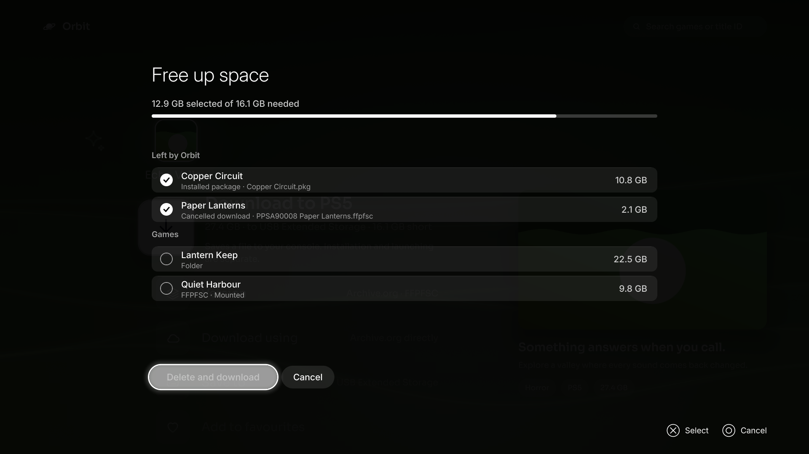
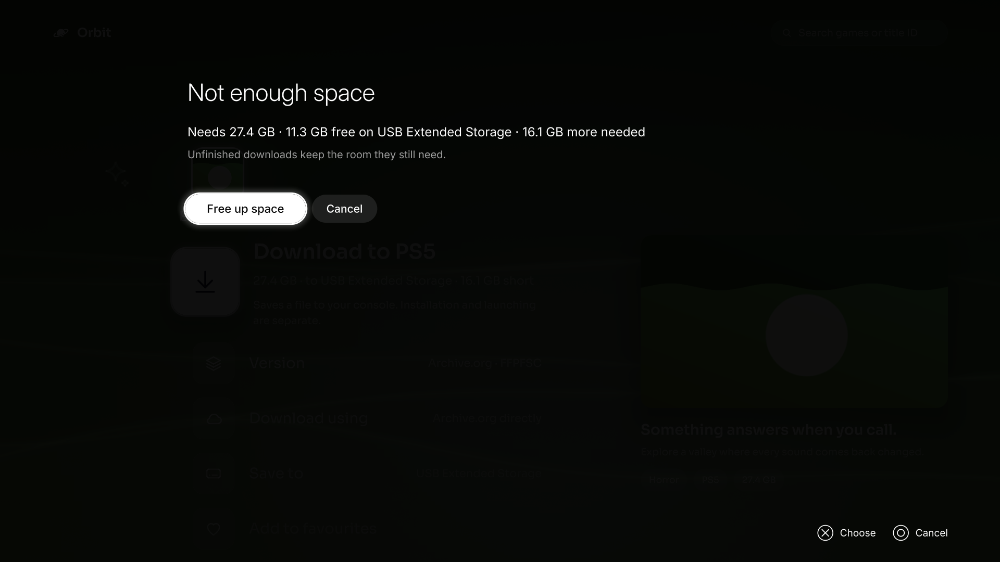
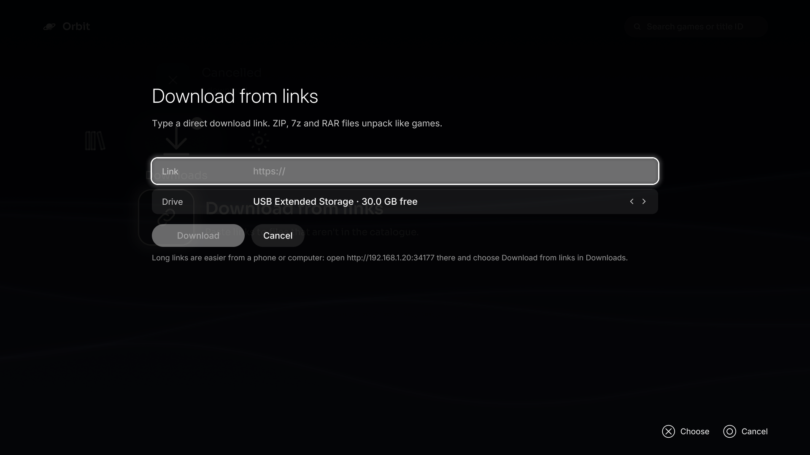

# Orbit Store 1.9.7 (Beta)

> **🎉 OrbitNet is coming soon: online multiplayer for jailbroken PS5s.** From the developer of Orbit. Follow along at [getorbitnet.com](https://getorbitnet.com).

**Orbit can now free up space and make room for your new download and can now also download files from your own custom links.**

## Orbit Store · Native PS5 app (FFPKG) and browser (ELF)

- **Free up space.** When a game doesn’t fit on its drive, Download no longer stays greyed out. Orbit shows what you could delete to make room: its own leftovers, such as packages your PS5 has already installed, archives kept after unpacking and downloads you cancelled, are ticked for you, and, with ShadowMountPlus running, your games are listed for you to choose. Orbit deletes what you pick, then starts the download. Your saves are never touched. You’ll also find **Free up space** in Library, and on a download that paused because there wasn’t room to unpack it.
- **Download from links.** In Downloads, select **Download from links** and paste up to 20 direct download links to download files that aren’t in the catalogue. If a link expires, select **Replace link** and paste a fresh one: the download carries on from where it stopped.
- **Sort by Recently added.** Browse can now show the games added to the catalogue most recently first.
- **33 more games.** The catalogue now has 3,090 games (1,351 PS5 and 1,739 PS4), including Grounded, Inscryption, Death’s Door, Red Matter 2 and The Legend of Heroes: Trails into Reverie. You’ll find them first in New on Orbit.
- **TorBox fix.** When TorBox’s download server can’t be reached from your network, Orbit now asks TorBox for a fresh link, which can point to another server. If that doesn’t help either, it tells you to try a different CDN in your TorBox settings.
- **Kraken Mount.** The release now also includes the TV app as a folder, `PPSA99177.zip`, for Kraken Mount, which doesn’t run FFPKG files.

All of this works in every look of the TV app and in the browser version.

## Orbit Zero · Mac, Windows and Linux

- **Free up space,** as on the PS5. For a download that goes through your computer, Zero first checks that it can start, so nothing is deleted for a download that can’t.
- **Download from links** and **Replace link,** as on the PS5.
- **Sort by Recently added** in Browse.

> **Orbit stays free.** [Orbit Store](https://github.com/saawant12/orbit-store-ps5), [Orbit Zero](https://github.com/saawant12/orbit-store-ps5#orbit-zero-for-mac-windows-and-linux), [Orbit Play](https://github.com/saawant12/orbit-play-ps5) and our upcoming apps are free and will stay free.
>
> I’ve been building Orbit in my own time and covering the costs of AI tools, test consoles, hardware and servers. If you’d like to help, you can [support Orbit via crypto](https://github.com/saawant12/orbit-store-ps5/issues/131#user-content-support-with-crypto). It’s entirely optional.

[Install Orbit Zero on Mac, Windows or Linux](https://github.com/saawant12/orbit-store-ps5/blob/main/guides/orbit-zero-installation.md) · [Install Orbit Store on PS5](https://github.com/saawant12/orbit-store-ps5/blob/main/guides/getting-started.md#install-the-native-tv-app)

  

  
  

 

## Install Orbit Zero on your computer

Choose the package matching your computer from **Assets**: macOS DMG, Windows installer or ZIP, or Ubuntu/Debian DEB. Linux TAR.GZ packages are also available. Both ARM64 and x64 builds are included; Linux DEB names use **amd64** for Intel/AMD computers. Quit the older app before installing the new version. See the [installation guide](https://github.com/saawant12/orbit-store-ps5/blob/main/guides/orbit-zero-installation.md) for setup and operating-system permissions.

## Install the native TV app (FFPKG)

Download `PPSA99177.ffpkg` from **Assets**, verify its `.sha256`, and copy it to `/data/homebrew/` on your PS5. Let ShadowMountPlus register it, then open **Orbit Store** from the Games row. Native app **1.13.7** includes the matching Orbit Store **1.9.7** service.

Using Kraken Mount instead of ShadowMountPlus? Download `PPSA99177.zip` and its `.sha256`, verify the checksum, unzip it and copy the `PPSA99177` folder to `/data/homebrew/`. Kraken Mount adds **Orbit Store** to the home screen.

If an older Orbit service is running, select **Stop Orbit to restart** in its browser interface before opening the updated app so the new service can start. Pairing, settings and your queue remain saved. This control is under **App settings → Updates & startup** in this release; older releases may call the section **Update / reinstall** or **Updates**. [Native installation and update guide](https://github.com/saawant12/orbit-store-ps5/blob/main/guides/getting-started.md#update-the-tv-app).

## Use or update the browser version (ELF)

Download `orbit_store.elf` and its `.sha256` from **Assets**, verify the checksum, then run the ELF through Payload Manager or your ELF loader. Open the Orbit shortcut in the Media tab, or `http://<ps5-ip>:34177/` on another device on the same local network.

To replace a running older version, select **Stop Orbit to restart**, then launch the new ELF. Orbit Zero can upload Orbit under **Settings → Updates & startup → Start Orbit on PS5**. It checks the official feed for a newer compatible service; its included offline fallback is PS5 service **1.9.7**.

On Orbit 1.5.0 or later, **Update Orbit** updates the TV app and the service together. In the native app from 1.8.2 on, select **Close and reopen** when asked; the reopened app starts its bundled service. Browser-only users can restart automatically with an active ELF loader on port 9021, or launch the updated ELF manually through their payload manager.

## Downloads and source

- **PS5:** `PPSA99177.ffpkg` includes the native TV app and download service. `PPSA99177.zip` is the same TV app as a folder, for Kraken Mount. Use `orbit_store.elf` to run the service and browser interface on their own.
- **Mac, Windows and Linux:** choose the `Orbit-Zero-1.9.7-*` package for your operating system and processor. These installers work with both PS5 and PS4. They include the PS5 1.9.7 service, whose source is in this release’s source bundle, and elfldr a481740, whose source and licences are in the [PS4 0.0.3 source bundle](https://github.com/saawant12/orbit-store-ps4/releases/tag/v0.0.3).
- **Source code:** `orbit-store-1.9.7-source-bundle.zip` includes the Store source code, dependencies, licence notices and build instructions.
- **Checksums:** use `SHA256SUMS` to check your download, or run `shasum -a 256 -c <filename>.sha256` for the ELF, FFPKG or ZIP.

  

