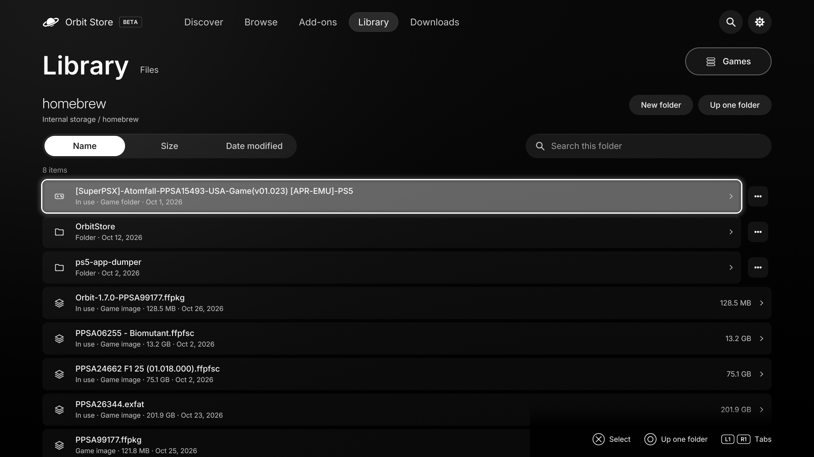

# Manage files on your PS5

**For Orbit 1.7.0.** Use the matching ELF, native app and Orbit Zero.

Open **Library → Files** in the browser, native TV app or Orbit Zero. Choose internal storage, a connected USB drive or an available M.2/extended drive. Each drive shows its free space.

*Files in the native PS5 app. Select a folder to open it; use its … button for actions.*

## Browse folders and choose actions

Select a folder to open it. **Circle** or **Escape** returns to its parent folder, then the drive list, then Library. An open dialog or menu closes before you leave the folder. **Up one folder** and **All drives** are also available on screen.

In Store and Cinema, use the folder row’s **…** button for its actions; selecting a file opens its details and actions. Crossbar keeps actions in the selected row’s menu. Panorama shows the selected entry’s actions beside the folder tiles. Search applies to the open folder, with sorting by name, size or date.

Files shows ordinary files and folders, including packages, images and archives. Hidden/system entries and Orbit’s own working files are excluded. It does not follow symbolic links. Folders containing more than 2,000 visible entries show the first 2,000.

## Copy, move, rename and delete

- **Copy** or **Move:** choose the item, navigate to the destination folder, then select **Paste here**. Copy keeps the original. Move removes it only after the copy succeeds; a move within one drive may finish immediately.
- **New folder** or **Rename:** enter the name. Existing names are not overwritten.
- **Delete:** review the path and confirm. This deletes the file or folder, not a PS5 game installation, and cannot be undone.
- **Measure size:** totals a folder’s contents.

File operations run one at a time. Copy and move have pause/resume controls; operations other than installations can be cancelled while their worker is running. Cancelling cannot undo files already deleted or an already completed move. A copied file or directory appears at its final destination only when copying completes.

Pause active Orbit downloads and transfers before changing files. New downloads wait while a Files operation owns the storage. Orbit also protects its settings, files used by downloads or installers, and games registered or mounted by ShadowMount. If a source changes during copying, Orbit stops instead of publishing an incomplete copy or deleting the original.

## Unpack and install

**Unpack here** supports ZIP, RAR and 7z. Orbit tries its known passwords, then asks for a password if needed. Files keeps the original archive. Existing extracted items are not overwritten.

**Install on PS5** uses the console’s package installer for PKG/FPKG files. For game images and game folders it asks ShadowMount to register them. ShadowMount 1.7beta5 or newer can add supported games from folders outside `homebrew`; older versions may ask you to move them into `homebrew` first. Installation still depends on the game, firmware and jailbreak. See [installing games](install-games.md).

## Save a file to another device

On a paired phone or browser, **Save to this device** downloads the selected file. In Orbit Zero, **Save to this computer** writes it to the computer’s Downloads folder. An existing computer file is kept and the new copy receives a numbered name. The PS5’s own browser does not offer this action.

[Library](library.md) · [Installation](install-games.md) · [Troubleshooting](troubleshooting.md)
