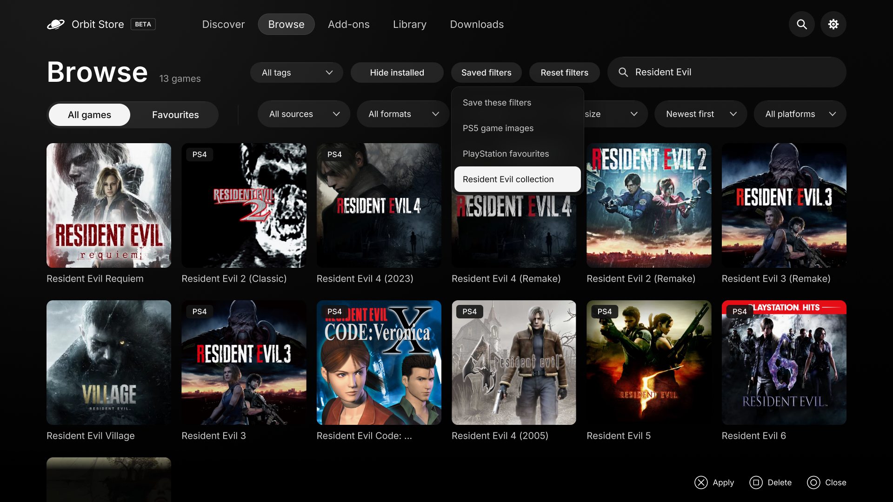

# Save your Browse and Add-ons filters

**For Orbit 1.8.0.** Update the Orbit apps you use from the [same release](getting-started.md#which-files-to-download); the native FFPKG includes its matching service.

Choose your filters, search and sort order in **Browse**, then open **Saved filters**. Enter a name and choose **Save filters**. Select a saved entry later to apply it.

*Saved filters in the native PS5 app, with example Browse presets.*

Browse and Add-ons have separate lists. Saving under an existing name replaces that entry; **Delete** removes only the saved selection, not any games or downloads. Orbit keeps up to 50 saved entries on the PS5.

The browser, native app and paired Orbit Zero share the console’s list in all four interfaces. Zero needs a connected PS5 to read or change that shared list; ordinary computer-only browsing remains available when disconnected. A filter can return different results as the catalogue changes.

[Browse and tags](downloads.md#game-tags) · [Appearance](appearance.md) · [Add-ons](add-ons.md)
