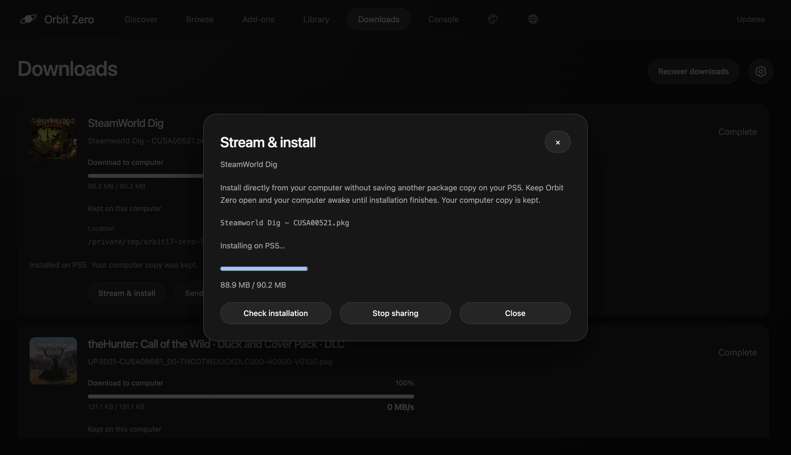

# Stream a computer download to the PS5 installer

**For Orbit 1.7.5.** Use the matching ELF, native app and Orbit Zero.

**Stream & install** lets Orbit Zero serve a finished PKG or FPKG directly to the PS5 installer over your local network. It avoids staging another complete package in the PS5’s download folder. The PS5 still needs space for the installed game and any temporary space its installer requires.

1. Download the game or add-on to **This computer**. For a ZIP, RAR or 7z archive, wait for extraction.
2. Pair or reconnect your PS5, running the matching Orbit 1.7.5 ELF.
3. Open the completed item in **Downloads**, choose **Stream & install**, and select the package. For a bundle, choose each package explicitly.
4. Keep Zero and the PS5 running until the console confirms installation.

*Stream & install in Orbit Zero, showing installation progress separately from the completed computer download.*

The computer copy is kept. Zero prevents idle sleep while sharing, protects that file from cache cleanup, and asks before quitting. Closing a laptop or losing power can still interrupt the connection. Allow Orbit Zero on your private network if your firewall asks.

Downloading, sharing and installation have separate states. **Stream & install** does not rebuild packages or change firmware, licence, base-game or DLC requirements. It is available in Zero’s four interfaces; the standalone ELF/browser and native app continue to install files already on the console.

## If the connection stops

Reconnect the original PS5 and choose **Check installation**. Zero can reopen its saved stream if the file, local address and port are unchanged. It does not automatically submit an uncertain installation again. Whether it can continue depends on the PS5 installer.

**Stop sharing** stops serving the computer file; it does not cancel the system installation. Cancel that task in PS5 Downloads, then check its status in Zero. If the console cannot report it, **End streaming session** lets you confirm that you cancelled it on the PS5 before starting again.

[Install downloaded games](install-games.md) · [Orbit Zero](orbit-zero.md) · [Troubleshooting](troubleshooting.md)
