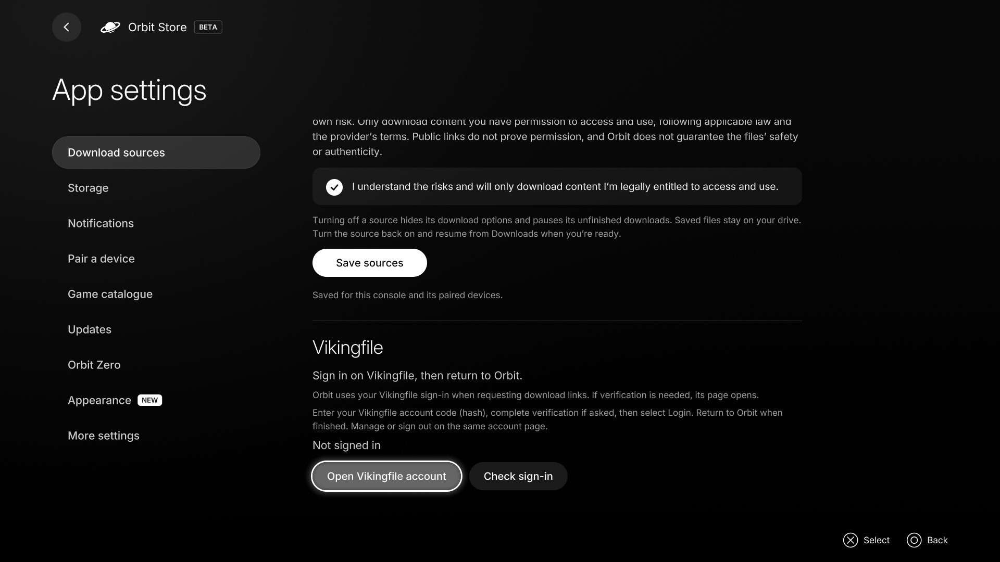

# Use a Vikingfile account

**For Orbit 1.7.5.** Use the matching ELF, native app and Orbit Zero.

Vikingfile identifies an account with an **account hash**: the private code it gives you instead of an email/password login. Treat it like a password and do not include it in issues, screenshots or diagnostic reports.

## On PS5

In the native TV app, open **App settings → Download sources** and scroll to **Vikingfile**. In the browser, open **App settings → Vikingfile** (or **Settings → Vikingfile** in Crossbar, Cinema and Panorama). Choose **Open Vikingfile account**. On the official provider page, enter your account code, complete human verification if requested and select **Login**. Return to Orbit and choose **Check sign-in**.

*Native app preview before sign-in. No account code is shown.*

Orbit shows **Signed in** only after Vikingfile confirms the session. Opening the page alone does not count. To manage the account or sign out, reopen the same account page. The PS5 browser and native app use separate browser stores, so you may need to sign in once in each interface you use.

For download requests, Orbit reads only Vikingfile’s session for the active PS5 user. It does not expose cookies through its settings, API or diagnostics. This session check also supplies the sign-in indicator.

## On your computer

In Orbit Zero’s **Download settings → Vikingfile**, enter your account hash and choose **Sign in**. Zero fills the official page’s account field. Complete any human verification there. The account field is cleared after submitting; the resulting browser session stays on that computer. Use **Check sign-in** or **Sign out** in the same settings.

Computer sign-in and PS5 sign-in are separate. Pairing does not copy credentials between them.

## Downloading after sign-in

Orbit first asks Vikingfile for the selected file using the signed-in session. If Vikingfile supplies a matching direct link, the download can start without opening a provider window. If it requires verification, the page opens: complete verification and wait without pressing Download. Orbit captures the matching ready link and returns to the app.

Premium privileges are controlled by Vikingfile. A **Signed in** status does not claim premium membership or guarantee every file will skip verification. Expired sessions and provider challenges fall back to the provider page; sign in again if needed. Free-account downloads remain supported.

[Download guide](downloads.md) · [Orbit Zero](orbit-zero.md)
