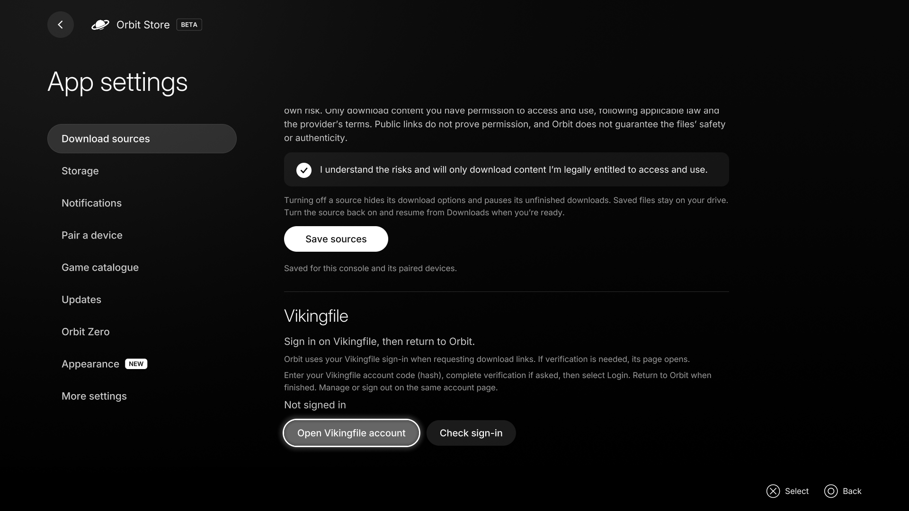

# Use a Vikingfile account

The settings paths below follow Orbit 1.9.1. Update the Orbit app handling your download and, for PS5 downloads, its running service. The native FFPKG includes the matching service; see [which files to download](getting-started.md#which-files-to-download).

Vikingfile identifies an account with an **account hash**: the private code it gives you instead of an email/password login. Treat it like a password and do not include it in issues, screenshots or diagnostic reports.

## On PS5

In the native TV app, open **App settings → Sources & accounts** and scroll to **Vikingfile**. In the browser, open **App settings → Sources & accounts → Vikingfile** (or **Settings → Sources & accounts → Vikingfile** in Crossbar, Cinema and Panorama). Choose **Open Vikingfile account**. On the official provider page, enter your account code, complete human verification if requested and select **Login**. Return to Orbit and choose **Check sign-in**.

*Native app preview before sign-in. No account code is shown.*

Orbit shows **Signed in** only after Vikingfile confirms the session. Opening the page alone does not count. To manage the account or sign out, reopen the same account page. The PS5 browser and native app use separate browser stores, so you may need to sign in once in each interface you use.

Orbit uses the selected browser session when resolving and checking the file link, downloading it and resuming it. On PS5, it reads only Vikingfile’s session for the active user; Zero uses its own provider session. These cookies are not stored in download history, exposed in diagnostics or sent to TorBox or unrelated hosts. The session check also supplies the sign-in indicator.

## Use a pass from another device

**Needs Orbit 1.9.2 or later.**

If Vikingfile’s sign-in page freezes or closes on your PS5, you can sign in on another device instead and give Orbit that sign-in, called a *pass*. Vikingfile stores it in your browser as a cookie named `PHPSESSID`.

1. On a computer, open vikingfile.com in Chrome, Edge, Firefox or Safari and sign in with your account code.
2. Open the browser’s developer tools: press F12, or ⌥⌘I on a Mac. In Safari, first turn on **Settings → Advanced → Show features for web developers**.
3. Find the cookies: **Application → Cookies** in Chrome and Edge, or **Storage → Cookies** in Firefox and Safari. Select vikingfile.com.
4. Copy the **Value** of `PHPSESSID`.
5. Open Orbit in a browser on your computer or phone and go to the Vikingfile settings. Paste the value into **Sign-in pass (PHPSESSID)** and choose **Save pass**.

Phone browsers don’t show cookies unless you add a cookie viewer, so copying the pass is easiest on a computer. You can paste it from any device.

Orbit checks the pass with Vikingfile before saving it and shows **Pass saved and signed in**. The pass is kept only on your PS5 and never shown again. Treat it like a password. The native app shows the pass status under **Vikingfile**, with **Forget pass**.

Orbit tries the pass first for Vikingfile downloads. If Vikingfile has ended it, Orbit uses the PS5’s own sign-in, if any, and the settings say **Vikingfile has signed this pass out**. Copy a new one the same way. Signing out on vikingfile.com in that browser also ends the pass, so close the tab instead.

## On your computer

In Orbit Zero’s **Settings → Sources & accounts → Vikingfile**, enter your account hash and choose **Sign in**. Zero fills the official page’s account field. Complete any human verification there. The account field is cleared after submitting; the resulting browser session stays on that computer. Use **Check sign-in** or **Sign out** in the same settings.

Computer sign-in and PS5 sign-in are separate. Pairing does not copy credentials between them.

## Downloading after sign-in

Orbit first asks Vikingfile for the selected file using the signed-in session. If Vikingfile supplies a matching direct link, the download can start without opening a provider window. If it requires verification, the page opens: complete verification and wait without pressing Download. Orbit captures the matching ready link and returns to the app.

Premium privileges are controlled by Vikingfile. A **Signed in** status does not claim premium membership or guarantee every file will skip verification. Expired sessions and provider challenges fall back to the provider page; sign in again if needed. Free-account downloads remain supported.

[Download guide](downloads.md) · [Orbit Zero](orbit-zero.md)
